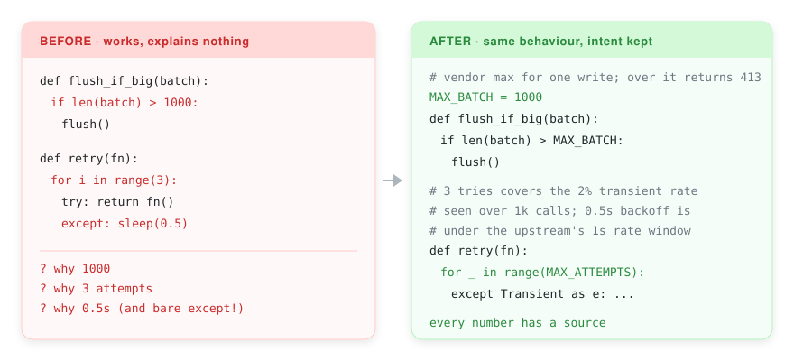

<p align="center">
  <em>You are not the person who will read this code. You are the person who will debug it at 3am.</em>
</p>

<p align="center">
  
  
  
</p>

<p align="center">
  
</p>

<p align="center"><sub><a href="i18n/README.zh-CN.md">简体中文</a></sub></p>

---

An Agent Skill that finds the places where code withholds what a future reader
needs, and fixes them.

## The failure it targets

Code that works is not the same as code that explains itself. The gap is invisible
at write time and expensive at read time:

```python
if len(batch) > 1000:          # why 1000?
    flush()

MAX_BATCH = 1000               # vendor max for one write; over it returns 413
if len(batch) > MAX_BATCH:
    flush()
```

A reader will ask three questions at 3am: what was this supposed to do, what did
the author assume, where do I look next. The first version answers none.

## Quick start

```bash
git clone https://github.com/WsNodeX/inheritor ~/.claude/skills/inheritor
```

Or as a Claude Code plugin:

```bash
/plugin marketplace add WsNodeX/inheritor
/plugin install inheritor
```

Then point it at code — `Use the inheritor skill on src/.` — or run the checker:

```bash
python scripts/inheritance-check.py --path src/
```

```text
orders.py:47   [R1] literal 1000 decides behaviour — name it or say where it came from
orders.py:88   [R3] TODO has no exit condition — add when it is safe to remove
orders.py:201  [R8] normalize() mutates argument 'records' — say so

4 files · 0 fail · 4 warn
```

## The eight rules

| # | Rule | Fails when |
|---|---|---|
| 1 | Name for the search box | You cannot grep the name and land on the right place |
| 2 | Comments answer *why* | The comment copies the line below it |
| 3 | Every number gets a source | A literal decides behaviour and nobody said why |
| 4 | Errors must be actionable | It says something failed, not what to check |
| 5 | A TODO needs an exit condition | Nobody can tell when it is safe to remove |
| 6 | Every module gets a map | A reader cannot find the entry point |
| 7 | Commit says *why* | The message repeats the diff |
| 8 | No implicit contracts | A function assumes something unwritten |

Rules 1, 3, 4, 5, 8 are machine-checkable and implemented. Rules 2, 6, 7 need
judgement; `references/patterns.md` covers them with before/after pairs.

## What it will not do

**Not flag every undocumented function.** An early version did and emitted 41
warnings on a healthy codebase; a tool that cries wolf gets ignored. Rule 6 now
fires only on public functions with two or more unannotated parameters.

**Not tell you to add comments.** A comment restating the code is worse than none:
it rots while looking authoritative. The fix for rule 2 is usually a better name.

## Why this exists

Most code-quality advice optimizes the code. This optimizes the reader.

The two disagree more often than you would expect: a clever one-liner with an honest
name beats a six-line expansion nobody can follow. Rule #3 earns its keep because an
unexplained literal is a decision with its justification deleted — the most common
way a codebase forgets why it works.

## Limitations

- **Python only, for now.** The checker uses `ast` and `tokenize`; the prose rules
  are language-agnostic.
- **It cannot recover intent that was never recorded.** If the reason for a constant
  lives in a deleted thread, the checker can say it is undocumented, not what it means.

Sister project: [readme-forge](https://github.com/WsNodeX/readme-forge) — the same
principle applied to READMEs.

## License

MIT
